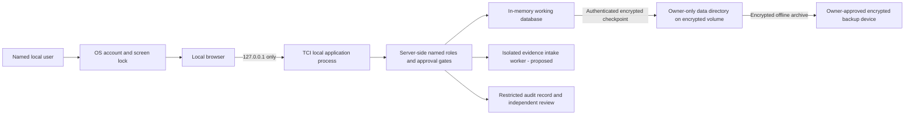
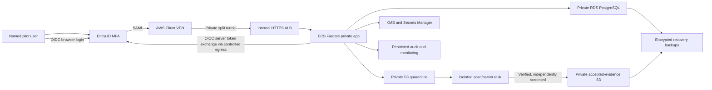

# ANLAQ TCI™ private pilot — two architecture options
Version 0.9.1-readiness.2 · 27 November 2026 · Proposed, not provisioned

## Recommendation
Start with Option A (owner-managed local workstation) for the next synthetic pilot and methodology calibration if everyone can use the same machine. It has the smallest operational footprint and no recurring cloud hosting requirement. Choose Option B (AWS Singapore) if independent assessors need concurrent access from different devices or locations. Neither option permits actual client records, public application access, production scoring, external models, or deployment without separate approval.

| Decision | A — Local workstation | B — AWS private cloud |
|---|---|---|
| Intended cohort (proposal) | Up to 4 named users, physically using one workstation | Up to 10 named synthetic pilot users through private VPN |
| Access | Browser on 127.0.0.1 only; no LAN/remote access | Federated VPN, internal HTTPS app, separate application sign-in |
| Compute | Apple Silicon macOS, local service | ECS Fargate task in private subnet; internal ALB |
| Durable evidence design | Local encrypted volume and sealed local archives; integration still required | Private encrypted PostgreSQL and S3, customer-managed keys |
| Identity | Separate named OS and app accounts; local role lifecycle design | Proposed Microsoft Entra ID SAML VPN and OIDC app with MFA, if tenant/licensing confirmed |
| Independent reviewer | Separate account and distinct human on shared machine | Separate account and distinct human on own device |
| Availability | Workstation powered on; single-machine dependency | Two-AZ network; single-task and single-AZ DB pilot compromise; not HA |
| Incremental planning allowance | USD 0–40/month, existing workstation; no cloud fees | USD 450–900/month; unverified planning envelope |
| Future multi-client scale | Poor fit; migration needed | Better fit, after security and capacity acceptance |
| Current status | Loopback synthetic demo works; persistent local integration and machine review open | Design only; no AWS or IdP resources deployed |

## A — Local architecture

No listener on LAN or the internet, no remote invitation, no tunnel, no cloud sync or cloud backup for pilot records. Separate named OS accounts and independent named app accounts; operator cannot act as independent reviewer for their own work. The existing local launcher is an ephemeral synthetic demo and prints temporary passwords; it is NOT the intended persistent pilot service. Implement a packaged non-admin local process, named membership provisioning/revocation, local session expiry, and fresh authentication after restart. Confirm workstation encryption (FileVault or equivalent), screen lock, supported OS updates, owner-only ACLs, memory/storage capacity and backup destination before local operational approval. Device check: Apple Silicon and free disk space observed; RAM and volume-encryption status not verified from the current execution environment. Do not infer machine security.

Data model: preserve the tested in-memory data plane and implement durable encrypted checkpoints with independent vault/evidence/audit keys from approved local key storage; authenticate archive, strip sessions, verify methodology and audit on recovery. Explicit transactional checkpoint/restore behavior, atomic replacement of the current checkpoint, versioned retained archives and protecting against concurrent launches or unintended rollback are IMPLEMENTATION work, not present capabilities. No plaintext persistent evidence metadata outside encrypted storage. Recovery reference already exists but does not run automatically or integrate with launcher. Keep keys separate from backups; confirm secure key recovery custody, do not use source repo or synced directory. Retention/deletion and legal/evidence holds need approval; synthetic archive expiry blocks restore but does not delete. Parser worker isolation and fail-closed scan are not yet implemented. Local owner-controlled recovery and audit export exercise must be independently witnessed. Single machine cannot deliver high availability or independent audit administration; no remote operation without separate architecture review.

## B — AWS reference architecture

Proposed separate AWS pilot account, Singapore region ap-southeast-1, two availability zones for VPC/internal ALB/VPN target networks, a single low-volume Fargate app task (0.5 vCPU / 1 GiB starting hypothesis) and private single-AZ PostgreSQL (20 GiB starting hypothesis) for a synthetic pilot only. No public app or DB IP, no public object storage, no direct inbound app route. VPN endpoint is internet-reachable for authenticated VPN connections, not a public application. Restrict VPN access to app subnet/required private DNS; do not give users database/storage access. Internal HTTPS load balancer and trusted internal DNS/certificate; app remains separate authentication boundary. Private task/service access by VPC endpoints where available; controlled outbound HTTPS for identity discovery/token exchange only (egress policy must be validated); external model endpoints disabled. No provider account, tenant, licence, certificate or DNS has been confirmed.

Identity: proposed existing Entra tenant, SAML VPN federation and application OIDC auth-code + PKCE, MFA via identity policy. Server-side identity library validates issuer/audience, signature/time, nonce/state and tenant; application-managed mapping of immutable identity to active assessment membership, not untrusted UI claims. No self-registration, shared accounts, browser local token persistence or password fallback. Session expiry/logout/revocation tested; independent reviewer and owner gates retained. Dedicated app registration and private redirect URI validation required; if Entra unavailable, redesign and reapprove, not a silent substitution. Role mapping and separation: contributors upload own evidence; assessors inspect/draft; reviewers independently accept/return; owner controls direction/release, admins operate platform not methodology. Avoid exposing real records in logs.

Persistence: migrate current SQLite semantics to PostgreSQL transactions, tenant-bound keys and append-only records; no direct production SQLite migration assumption. Evidence payloads in segregated quarantine and accepted-object buckets, version and digest in database. S3 public access blocked, TLS and customer-managed encryption, separate keys for evidence, audit and backup; scoped app/scanner role. Fail closed when scanning/parser validation unavailable; no accepted source before human screening. Private storage endpoints, no publicly shareable evidence links. Durable external audit with restricted writers/readers and approved retention, security/operational monitoring, no raw document text or credentials in event logs. Key management, backup/restore, rotation and retention/deletion exercise required; do not imply that local archive tests prove managed services. Single task and DB are explicit availability compromises; test recovery before cohort UAT, revisit redundancy before critical service. Models and production scoring disabled; no real client processing.

## Cost planning (not a provider quotation)
The machine-readable cost model uses illustrative allocations, 730 monthly hours, ten named users, 160 total VPN connection-hours and low traffic. AWS pricing is region/usage dependent: VPN association and connection time, load-balancer hours and processed capacity, Fargate CPU/memory, database compute/storage/backup, endpoint-hours/data and logging/key services. USD 450–900 monthly is a planning reserve, not a Singapore price calculation or spending authorisation; exclude taxes, Microsoft licensing, engineering time and major usage/HA increases. Confirm a regional calculator estimate and approved limit before provisioning. Local USD 0–40 incremental allowance assumes existing machine; excludes purchase, backup device, engineering time and variable power costs. No new paid service required for the current local demo. Do not present these allowances as quotes.

## Official references (reviewed for design/billing basis)
- AWS region codes: https://docs.aws.amazon.com/global-infrastructure/latest/regions/aws-region-billing-codes.html
- Client VPN architecture/authentication/pricing: https://docs.aws.amazon.com/vpn/latest/clientvpn-admin/what-is.html ; https://docs.aws.amazon.com/vpn/latest/clientvpn-admin/federated-authentication.html ; https://aws.amazon.com/vpn/pricing/
- ECS private networking/internal load balancing: https://docs.aws.amazon.com/AmazonECS/latest/developerguide/networking-outbound.html ; https://docs.aws.amazon.com/AmazonECS/latest/developerguide/networking-connecting-services.html
- PrivateLink: https://docs.aws.amazon.com/vpc/latest/privatelink/privatelink-access-aws-services.html
- Entra OIDC: https://learn.microsoft.com/en-us/entra/identity-platform/v2-protocols-oidc
- Relational storage encryption: https://docs.aws.amazon.com/AmazonRDS/latest/gettingstartedguide/advanced-security.html
- S3 access protection: https://docs.aws.amazon.com/AmazonS3/latest/userguide/access-control-block-public-access.html
- Cost basis: https://aws.amazon.com/fargate/pricing/ ; https://aws.amazon.com/rds/postgresql/pricing/ ; https://aws.amazon.com/elasticloadbalancing/pricing/ ; https://calculator.aws/

## Decision and acceptance gates
Owner chooses A or B, approves named users and authorised synthetic scope, assigns independent design/security reviewer and operational owners; confirm machine encryption/backup/role provisioning if local, or provider account/region/IdP/quote/limit if AWS. Independently review design before implementation. Implement only selected option. Validate actual configurations, durable storage and restoration, access revocation, quarantine, audit, privacy/lifecycle, synthetic assessor UAT. All 13 operational gates remain open/unaccepted; no deployment or real-client permission. Offline ARCHITECTURE-CHECK-REPORT.json verifies declarations, not live settings. No infrastructure-as-code apply path exists and no resources were created.
